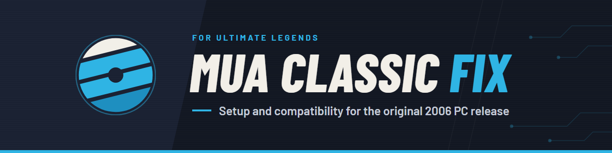

# MUA Classic Fix

**Play the original 2006 PC release of Marvel: Ultimate Alliance on a modern Windows PC, set up from your own disc.**

MUA Classic Fix turns your own retail DVD (an ISO, the mounted disc or a copy of its files) into a new, checked
installation and adds what the 2006 release needs today: it starts on current Windows, runs in a window, and works
with Xbox controllers, showing the game's own Xbox button art. It is made for
[Ultimate Legends](https://github.com/ChronoRixun/ultimate-legends), which does the whole setup for you.

This project ships no game content: no game files, no modified executables, no disc images. `Game.exe` stays
byte-for-byte as it is on your disc.

> **Current release: [0.2.0](https://github.com/ChronoRixun/muac-fix/releases/tag/v0.2.0)**, the first release.
> Automatic setup needs Ultimate Legends 0.5.0-beta.5 or newer.

## What it does

- **Sets up from your own disc.** The disc is only read. The original installer, its MSI custom actions and its
  InstallShield scripts never run. Every file is checked against the disc's installation database, hashed (SHA-256)
  and staged in a separate folder. The install is put in place only once every file checks out, and a cancelled or
  failed setup removes its own staging folder.
- **Starts on modern Windows.** The retail game's SafeDisc protection stops it on current Windows. Setup puts a
  source-built [SafeDiscLoader2](https://github.com/nckstwrt/SafeDiscLoader2) `version.dll` beside the unchanged
  `Game.exe`. No driver or system file is installed.
- **Xbox controllers, Bluetooth ones included.** The pad is presented to the game as a wired Xbox 360 controller,
  so it picks its own Xbox button art instead of numbered buttons. Your saved controller profiles and bindings are
  kept.
- **Windowed or borderless play.** Graphics go through [dgVoodoo2](https://github.com/dege-diosg/dgVoodoo2), set up
  for a normal window at the resolution you choose in the game. Your desktop resolution never changes. The mouse
  can leave the window, and the game keeps running while you use another window (minimize still works).
- **Online redirect.** The game's GameSpy lookups go to [OpenSpy](https://openspy.net) instead of the closed
  GameSpy servers.

## What you need

| | |
|---|---|
| **Marvel: Ultimate Alliance (2006) for PC, retail DVD** | Your own disc, as an ISO, the mounted DVD or a copied disc folder. Supported: the English PC DVD with MSI product code `{932FB3F3-594D-4600-ABFA-F2DE80A14214}`. The 2016 Steam release is a different build; for it, use [MUA Controller Fix](https://github.com/ChronoRixun/mua-controller-fix). |
| **Windows** | Tested on Windows 11. |
| **Disk space** | About 7 GB for the game, plus room for temporary cabinet extraction when you set up from an ISO. |
| **Ultimate Legends 0.5.0-beta.5 or newer** | For automatic setup. Manual setup (below) doesn't need it. |

## Getting started

### With Ultimate Legends (recommended)

1. In [Ultimate Legends](https://github.com/ChronoRixun/ultimate-legends), open **Marvel: Ultimate Alliance (2006
   PC)** and choose **Set up**.
2. Pick your disc ISO or disc folder, then a new or empty folder for the game.
3. The launcher downloads this project's checked `muac-setup` package from your update channel, plus the original
   dgVoodoo2 2.87.6 archive. It checks both against their SHA-256 and runs setup on your PC. You can hide or cancel
   setup, and an unfinished setup is never registered as ready.
4. **Play.** The game's page has the window, input, mouse and OpenSpy options.

### By hand (command line)

1. Download `muac-setup-0.2.0-win64.zip` from the [release](https://github.com/ChronoRixun/muac-fix/releases/tag/v0.2.0),
   check it against `SHA256SUMS.txt`, and unzip it anywhere. It needs no Python.
2. Download `dgVoodoo2_87_6.zip` from [dgVoodoo2's official 2.87.6 release](https://github.com/dege-diosg/dgVoodoo2/releases/tag/2.87.6).
   Setup checks its SHA-256 and refuses any other file.
3. Run setup from the unzipped folder:

   ```powershell
   .\muac-setup.exe info   --source "D:\MyDisc.iso"
   .\muac-setup.exe setup  --source "D:\MyDisc.iso" --out "D:\Games\MUA-2006" --dgvoodoo "D:\Downloads\dgVoodoo2_87_6.zip"
   .\muac-setup.exe verify --out "D:\Games\MUA-2006"
   ```

4. Start `Game.exe` in the new folder.

`--source` takes an ISO, a mounted DVD drive or an extracted disc folder; `--out` must be a new or empty folder.
`info` identifies a disc or an installed game folder. `verify` re-hashes every file against the setup manifest
(`_muac/setup.json`) and lists anything missing or changed. It checks files only, not whether the game runs, so its
`runtime_verified` field is always `false`. `import` extracts the files without adding the compatibility runtimes.
Every command prints one JSON object per line.

Settings live in `muac-fix.ini` next to `Game.exe`; Ultimate Legends edits them for you. Changes apply the next
time the game starts.

```ini
[Input]
ControllerSupport=1   ; Xbox controller normalization and button art
CaptureMouse=0        ; 0 = the mouse can leave the window
[Display]
RunInBackground=1     ; keep running while another window has focus (windowed/borderless)
[Online]
Domain=openspy.net    ; off = no redirect; Server=<IPv4> overrides it for a private server
LocalIP=auto
```

Window mode, frame limit and VSync are dgVoodoo2 settings in `dgVoodoo.conf`. Keep its `CaptureMouse` off as well.
How the native fix works: [docs/runtime.md](docs/runtime.md).

## The release

[v0.2.0](https://github.com/ChronoRixun/muac-fix/releases/tag/v0.2.0) has three assets:

| Asset | What it is |
|---|---|
| `muac-setup-0.2.0-win64.zip` | The offline setup helper. Contains MUA Classic Fix's `dinput8.dll`, the source-built SafeDiscLoader2 `version.dll`, default `muac-fix.ini` and `dgVoodoo.conf`, every licence notice, and the corresponding source (this project, SafeDiscLoader2 at its pinned commit, and pycdlib). No game files, and no dgVoodoo2. |
| `muac-setup.json` | The manifest Ultimate Legends reads: version, the zip's size and SHA-256, and the minimum launcher version (0.5.0-beta.5). |
| `SHA256SUMS.txt` | The zip's SHA-256. |

How the package is built and checked: [docs/packaging.md](docs/packaging.md).

## Known limits

- **One controller.** One connected XInput pad is normalized. With more than one connected, the fix leaves them
  alone rather than risk sending one pad's input to another player.
- **Not certified yet:** every in-game controller mapping, saving and loading, and online play. The OpenSpy
  redirect is in place, but hosting and joining a game haven't been tested.
- **One disc edition.** Setup accepts the product code above, and automatic setup also needs the known retail
  `Game.exe`. Other editions and modified discs are refused, not guessed at.
- **ISO images** are read through their ISO9660/Joliet file system; UDF-only images are not supported.
- **No resume, repair or uninstall in the helper.** An interrupted setup starts again in a new or empty folder.
  `verify` reports damaged files but doesn't fix them. A plain `import` keeps its staging folder after a failure,
  for inspection.

## Credits and licences

MUA Classic Fix is [GPL-3.0-only](LICENSE). It builds on:

- **[SafeDiscLoader2](https://github.com/nckstwrt/SafeDiscLoader2)** by nckstwrt (GPL-3.0): retail startup on modern
  Windows. Pinned to commit `91b6b89` and built from source by the release workflow; its source ships in the package.
- **[dgVoodoo2](https://github.com/dege-diosg/dgVoodoo2)** by Dege: graphics. Not redistributed here. The launcher
  downloads the original archive from its official release, and setup verifies the archive and its x86 `D3D9.dll`
  by SHA-256 before using it ([terms](https://dege.freeweb.hu/dgVoodoo2/ReadmeGeneral/)).
- **[MUA Controller Fix](https://github.com/ChronoRixun/mua-controller-fix)** (MIT): the DirectInput adapter,
  from commit `893bef8`.
- **[XML2 Fix](https://github.com/ChronoRixun/xml2-fix)** (MIT): the OpenSpy DNS and local-IP rules and the cursor
  behaviour, from commit `a49d76c`.
- **[MinHook](https://github.com/TsudaKageyu/minhook)** 1.3.4 (BSD), vendored in `runtime/third_party/`.
  SafeDiscLoader2 brings its own MinHook copy and tiny-json (MIT).
- **[pycdlib](https://github.com/clalancette/pycdlib)** (LGPL-2.1) reads ISO images; Python and PyInstaller build
  the helper.
- The content guard is adapted from [Ultimate Legends](https://github.com/ChronoRixun/ultimate-legends) (GPL-3.0).

Full notices: [`licenses/`](licenses/) and [`packaging/THIRD_PARTY.txt`](packaging/THIRD_PARTY.txt). The package
carries every notice in its `licenses/` folder, and setup copies them into the game's `_muac/licenses/`.

## Legal

MUA Classic Fix is an unofficial, non-commercial fan project. It is not affiliated with or endorsed by Marvel,
Activision, Raven Software or Beenox. Marvel: Ultimate Alliance and all related names are trademarks of their
owners and are used here only to say which game this project works with.

Bring your own copy. This repository and its releases contain no game files, game executables (original or
modified), game assets or protection drivers. Please never attach disc images, game files or links to them in
issues.

## Development

Development needs Windows, Python 3.11 or newer (3.14 for packaging) and Visual Studio's C++ tools with CMake.

```powershell
pip install -e .
python -m unittest discover -s tests -v
python tools/check_no_game_content.py --all

cmake -S runtime -B build/runtime -A Win32
cmake --build build/runtime --config Release
ctest --test-dir build/runtime -C Release --output-on-failure
```

| Path | Contents |
|---|---|
| `src/muac_setup/` | The setup helper (`muac-setup`): disc reading, MSI and CAB extraction, verification, runtime setup |
| `runtime/` | The native `dinput8.dll` (controller, mouse, focus, OpenSpy redirect) and its tests |
| `packaging/` | Package pins, default configuration, third-party notices, locked build dependencies |
| `tools/` | `package_setup.py` (builds the release package) and the content guard |
| `docs/` | [Documentation index](docs/README.md) |

Read [AGENTS.md](AGENTS.md) before contributing: it sets the content boundaries (no game material, no personal
data) and the checks every change runs. CI runs the unit tests, the content guard and the native build on every
push.
